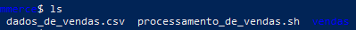
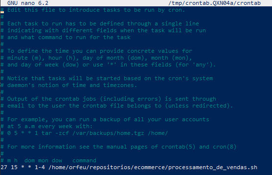

# Instruções

Neste arquivo você irá apresentar suas entregas da Sprint corrente. Observe que existem 4 diretórios no exemplo: **exercícios**, **certificados** e **evidências**.

- O diretório **exercícios** corresponde ao local onde você irá adicionar o código-fonte das atividades de codificação da Sprint, quando houver.
- O diretório **evidências** você pode utilizar para adicionar imagens demonstrando a execução/resultados de atividades, quando necessário.
- O diretório **certificados** é o local onde você irá armazenar os certificados dos cursos solicitados durante a sprint. O nome de cada certificado de corresponder ao título do curso.
- O diretório **desafio** é o local onde você irá armazenar a resolução do que se pede no desafio, todos recursos que você considerar importante deverá está dentro desse diretório.

Utilize o arquivo README.md da Sprint para organizar todas as suas entregas. Faça referência aos arquivos de código-fonte. Evite colocar código diretamente no Markdown pois dificulta nossa avaliação.

# Desafio

1. Codigo referente ao processamento de vendas ->
   [Processamento de Vendas](Desafio/ecommerce/processamento_de_vendas.sh)

2. Codigo referente ao consolidador de relatorios ->
   [Consolidador de Relatorios.](exercicios/ex2.txt)

3. Caminho da entrega dos desafios -> [Ecommerce.](Desafio/ecommerce/)

# Evidências

- Na execucao do codigo criado durante o desafio nota-se que e necessario existir um csv dentro da pasta para a execucao

  

- Para o script ser rodado todo dia foi necessario alterar o Crontab
  

# Aprendizados

## Curso Linux

Em linux ja tinha alguma familiaridade com algumas distribuicoes, e ao mexer no terminal, mas aprendi alguns comandos novos interessantes como

- touch
  - usado pra criar arquivos ou atualizar a data de acesso/modificacao
- man
  - usado para ver todas as informacoes de cada comando
- chmod
  - usado para alterar as permissoes de arquivos
- rmdir
  - um comando especifico para deletar pastas, ao inves de usar rm -r
- pwd
  - comando utilizado para ver o diretorio atual
- grep
  - pesquisa palavras dentro de textos
- find
  - encontra arquivos dentro de diretorios
- locate
  - encontra arrquivos dentro do sistema inteiro
- ifconfig
  - visualizacao da configuracao da rede
- netstat
  - informacoes sobre a rede

Tirando a parte dos comandos achei muito interessante a abordagem sobre o motivo do porque utilizar Linux como sistema operacional, abordando motivos como ser um sistema gratuito de codigo livre, ser bem maleavel gracas a isso e possibilidade de por exemplo em servidores criar a propria rede de seguranca

## Curso Git

Em git ja eu tive algumas experiencias tentando desenvolver projetos e utilizando a ferramenta github como armazenamento de repositorios, entao normalmente nao chegava a mexer com os comandos de git, somente o basico utilizado no ferramenta visual. 
Entao este curso me ensinou muito sobre como utilizar os comandos de git nos repositorios locais, e como gerenciar tambem um repositorio e boas
