# Desafio Sprint 10

Para a Sprint 10, foi necessário realizar uma análise dos dados reunidos e responder às perguntas formuladas no início do desafio final.

## Etapas

### Conjunto de Dados

Para realizar uma análise no QuickSight, foi necessário criar conjuntos de dados a partir de tabelas no Athena. Assim, foram gerados dois conjuntos:

- Conjunto contendo os filmes e a dimensão Tempo:

  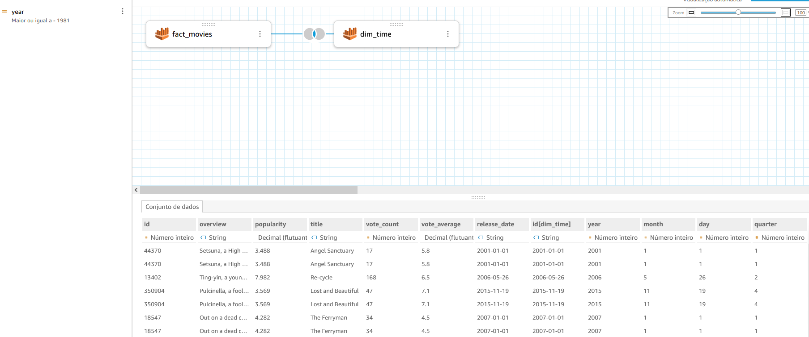

- Conjunto contendo os filmes e a dimensão Keywords:

  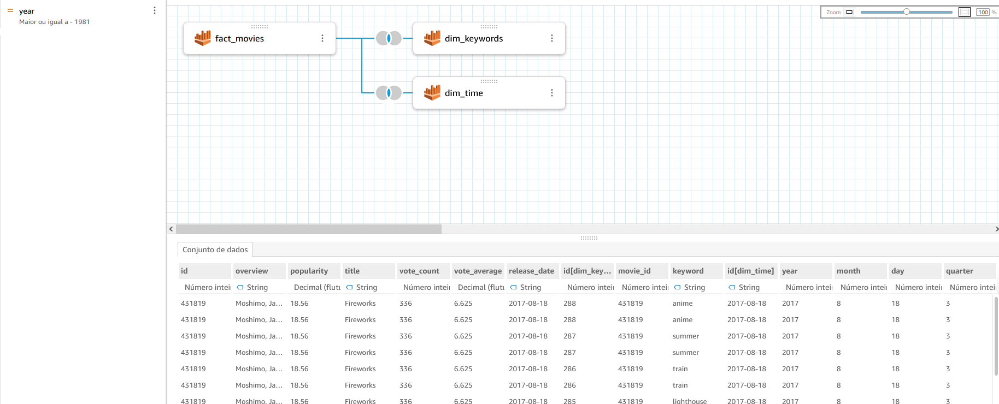

### Criação da Análise

A análise foi realizada em quatro áreas: Avaliação dos filmes, Popularidade, Quantidade e Palavras-chave. É importante destacar que todas essas informações consideram um período de 20 anos antes e 20 anos após o lançamento dos filmes. Em cada área, foi possível obter insights para responder às perguntas do desafio. A seguir, explico cada análise e as conclusões obtidas com os dashboards.

#### Análise por Avaliações

Nas avaliações, observamos métricas que comprovam a influência e o sucesso dos filmes da série _O Senhor dos Anéis_ em seus lançamentos.

No gráfico abaixo, nota-se que nos anos em que _O Senhor dos Anéis_ foi lançado, o filme obteve uma das maiores, senão a maior, nota anual entre os filmes de fantasia.

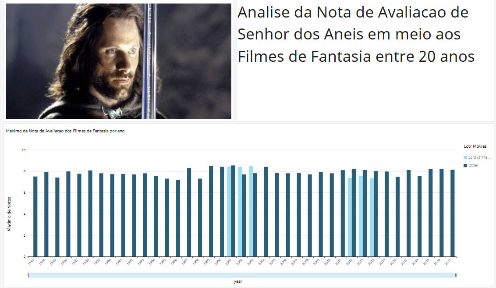

O gráfico a seguir também mostra a predominância de _O Senhor dos Anéis_ entre os filmes mais bem avaliados após seu lançamento.

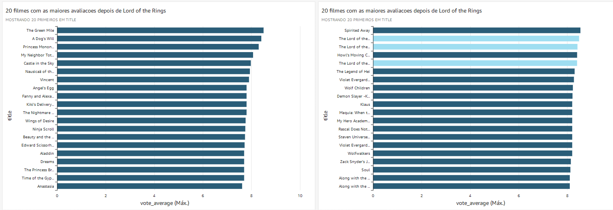

#### Análise por Popularidade

Quanto à popularidade dos filmes de fantasia, não é possível afirmar com certeza uma conexão direta ou influência dos filmes dessa série.

No entanto, é perceptível que a popularidade dos filmes aumentou após o lançamento de _O Senhor dos Anéis_.

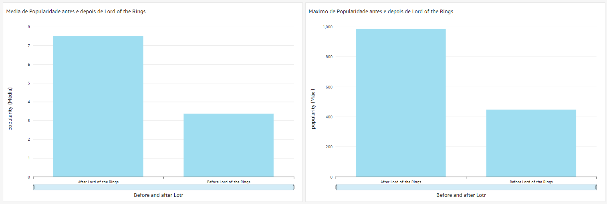

Acima, é possível ver que o aumento de popularidade pode estar relacionado ao lançamento de um filme em 2005, seguido por uma queda, mas com uma certa estabilidade nos anos seguintes.

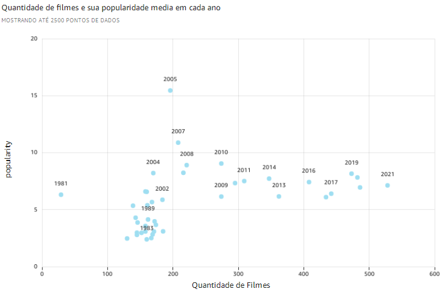

Embora _O Senhor dos Anéis_ não esteja no topo da popularidade, os filmes baseados nos livros de Tolkien permanecem entre os mais populares, ao lado de franquias como _Harry Potter_.

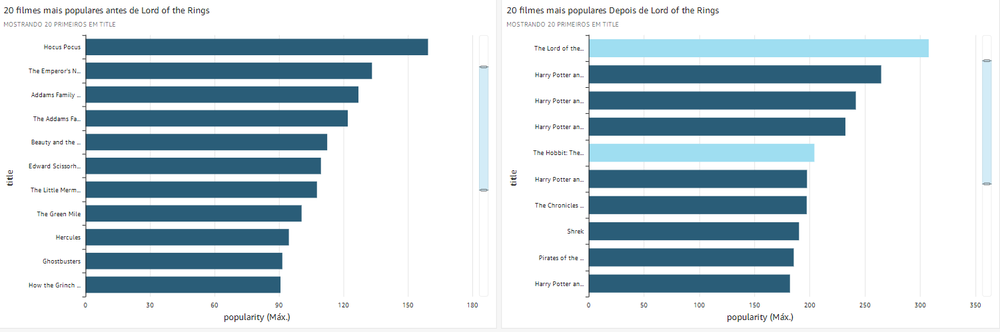

#### Análise por Quantidade

Na análise baseada na quantidade de filmes, ao comparar o período antes e depois do lançamento de _O Senhor dos Anéis_, surgem algumas observações interessantes.

O número de filmes lançados anualmente no gênero fantasia aumentou consideravelmente após o lançamento de _O Senhor dos Anéis_.

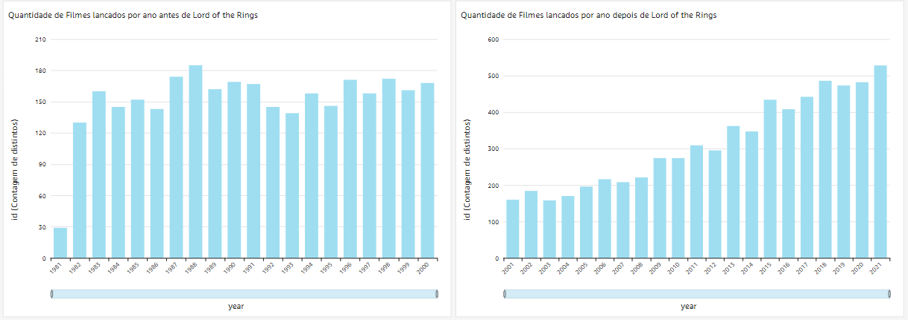

Outro gráfico a seguir também demonstra esse aumento na quantidade de filmes.

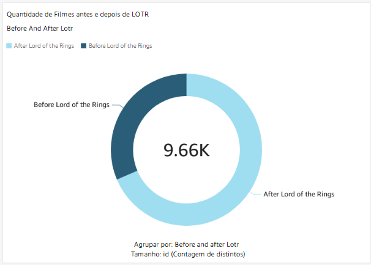

Acredito que a série de filmes _O Senhor dos Anéis_ possa ter incentivado essa maior produção de obras no gênero fantasia.

#### Análise por Palavras-Chave

Nessa análise, foram coletadas as palavras-chave dos filmes bem avaliados ao longo do período analisado. Algumas informações sugerem uma possível influência dos temas explorados em _O Senhor dos Anéis_ nos filmes de fantasia.

Antes do lançamento de _O Senhor dos Anéis_, as palavras-chave mais populares estavam relacionadas a "Animes". Na imagem, não é possível ver todas as palavras, mas a mais encontrada em diferentes filmes é "Sequência", indicando que filmes com histórias contínuas e mais detalhadas se tornaram mais comuns após o lançamento de _O Senhor dos Anéis_.

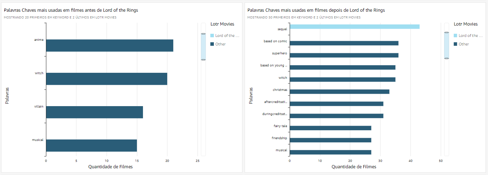

Outro ponto interessante é a relação entre as palavras-chave e as boas avaliações dos filmes, o que também sugere uma influência das palavras usadas nos filmes de Tolkien.

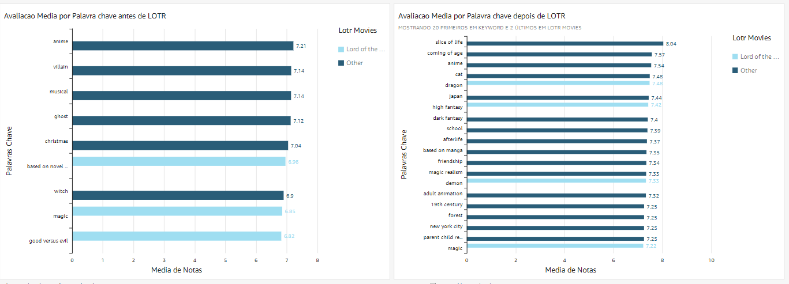

Essas observações indicam uma certa influência dos temas e palavras abordadas em _O Senhor dos Anéis_ quando comparados a outros filmes de fantasia lançados posteriormente.

### Dashboard em PDF

Aqui estão os arquivos que contêm os dashboards:

- [Folha-1](./Folha_1_2024-11-06T18_50_11.pdf)
- [Folha-2](./Folha_2_2024-11-06T19_51_13.pdf)
- [Folha-3](./Folha_3_2024-11-06T19_52_15.pdf)
- [Folha-4](./Folha_4_2024-11-06T19_48_45.pdf)

### Conclusão

Com as informações apresentadas nos dashboards, não é possível afirmar com certeza uma influência direta, mas o aumento de filmes de fantasia após o lançamento da série _O Senhor dos Anéis_ é evidente. Além disso, foi observado um aumento na qualidade e popularidade dos filmes do gênero, com muitas obras bem avaliadas explorando temas semelhantes aos de _O Senhor dos Anéis_ e _O Hobbit_.
