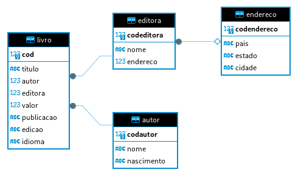
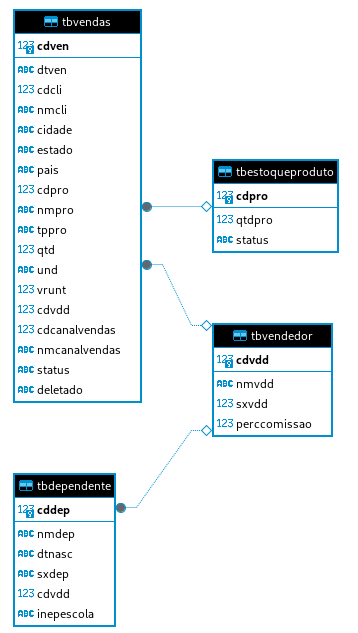

# Exercícios

## Exercícios referentes ao Caso de Estudo 'Biblioteca'

- [Resposta Ex1.](exercicios/ex1.sql)
- [Resposta Ex2.](exercicios/ex2.sql)
- [Resposta Ex3.](exercicios/ex3.sql)
- [Resposta Ex4.](exercicios/ex4.sql)
- [Resposta Ex5.](exercicios/ex5.sql)
- [Resposta Ex6.](exercicios/ex6.sql)
- [Resposta Ex7.](exercicios/ex7.sql)

## Exercícios referentes ao Caso de Estudo 'Loja'

- [Resposta Ex8.](exercicios/ex8.sql)
- [Resposta Ex9.](exercicios/ex9.sql)
- [Resposta Ex10.](exercicios/ex10.sql)
- [Resposta Ex11.](exercicios/ex11.sql)
- [Resposta Ex12.](exercicios/ex12.sql)
- [Resposta Ex13.](exercicios/ex13.sql)
- [Resposta Ex14.](exercicios/ex14.sql)
- [Resposta Ex15.](exercicios/ex15.sql)
- [Resposta Ex16.](exercicios/ex16.sql)

## Seção 6: Exercicios II

1. Etapa 1
   - [CSV Etapa 1](exercicios/ExercicioEtapa1.csv)
2. Etapa 2
   - [CSV Etapa 2](exercicios/ExercicioEtapa2.csv)

# Desafio

O Desafio desta Sprint é uma normalização de tabela para um modelo relacional e uma modelagem Dimensional desta tabela (Como um Cubo de dados), portanto foi separado em dois arquivos `.sql` para melhor entendimento

# Evidências

Vale ressaltar a questão de que o Banco de Dados é instanciado em um arquivo e não em banco, como é o caso do SQLite

Ao checar os exercícios percebe-se que estão divididos entre duas "Baterias", uma com os exercícios referentes a um caso de estudo onde a base de dados é uma biblioteca e outro caso de estudo onde a base é uma loja.

Para a Resolução dos exercícios foi utilizado o Cliente de SQL DBeaver, onde é possivel ver o Modelo Relacional Logico da estrutura de dados

Modelo Relacional Logico da Base Biblioteca

Modelo Relacional Logico da Base Loja

# Certificados

- Certificado do Curso de Sales Accreditation
  
