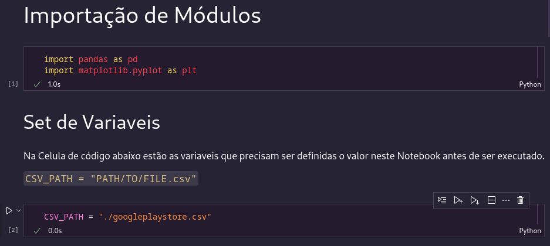
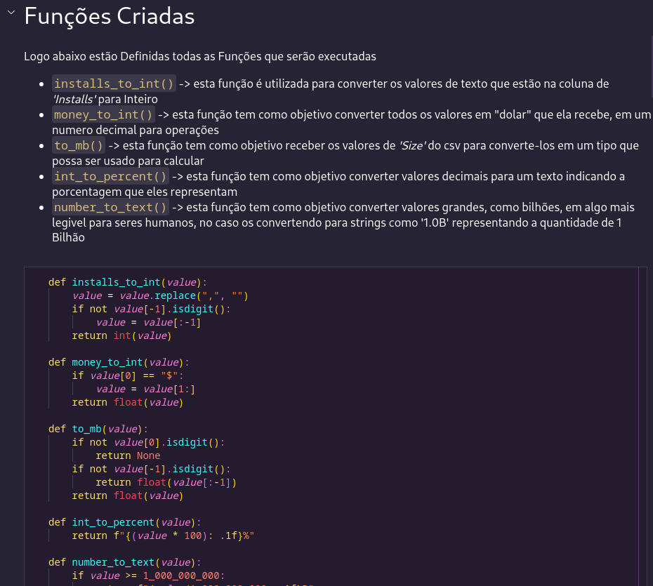
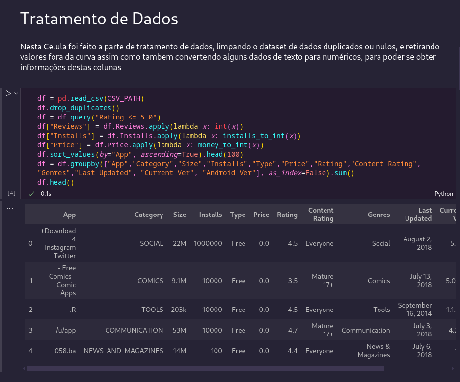
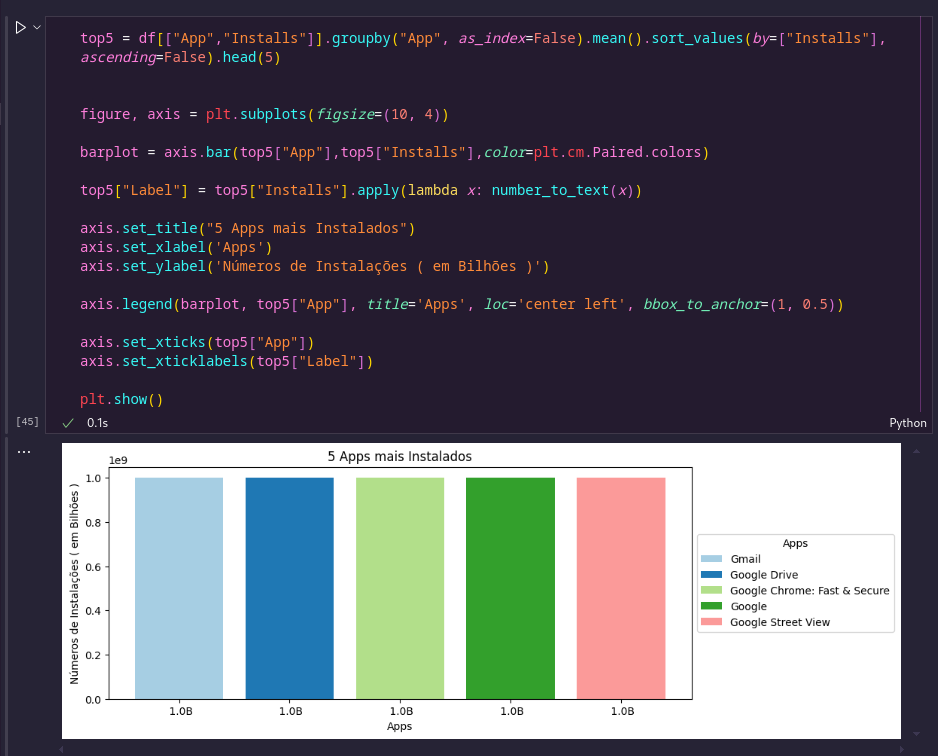

# Instruções para a Execução do projeto

> Este projeto esta sendo executado em um sistema operacional Linux: **_Fedora 40 Workstation_** portanto todos os comandos se referem a um Terminal Linux, se for executado em Windows utilize os comandos referentes ao Terminal Windows

## Criação do Virtual Enviroment

1. entre no diretório do Desafio pelo terminal
2. execute o comando `python -m venv ./.venv` para criar um ambiente virtual

> Dentro do diretório vai haver uma pasta chamada _.venv_ com todos os pacotes e arquivos executaveis de Python e versão que o seu sistema tem por padrão   

## Instalação dos Pacotes

1. Com o Ambiente virtual criado, o proximo passo é acessa-lo via terminal para poder instalar todos os Módulos necessários para este projeto
2. No terminal **Linux** Execute o comando `source ./.venv/bin/activate`, este comando acessa o ambiente virtual
3. Estando no Ambiente Virtual, execute o comando `pip install -r requirements.txt`, este comando vai instalar todos os pacotes necessarios para a execução deste projeto
   

## Desafio

O desafio desta Sprint é gerar gráficos usando dados de um CSV utilizando bibliotecas como _'Pandas'_ e _'MatPlotLib'_, Dentro do Diretório de Desafio existem os seguintes arquivos.

- [Notebook Contendo os códigos](challenge.ipynb)
- [Arquivo contendo as dependencias Python](requirements.txt)
- [CSV contendo os dados](googleplaystore.csv)

## Etapas

### Etapa 1

Durante a primeira etapa do desenvolvimento é feito a importação de todos os módulos necessários, a definição das variáveis necessárias para a análise e por fim a criação das Funções necessárias nos procedimentos posteriores

### Etapa 2

Após a primeira etapa é feito a criação do dataset com os dados, depois a filtragem e tratamento dos mesmos para que possa ser utilizado estatisticamente

### Etapa 3

Agora que temos os dados tratados, foi feito a geração de datasets para gerar gráficos

> Abaixo temos um exemplo de um dos códigos utilizados, onde é criado um dataset com os dados para o gráfico, então é feito os ajustes de tamanho de figura no matplotlib e a geração do gráfico, assim como o ajuste dos titulos e legendas para maior compreensão da informação trazida no gráfico

