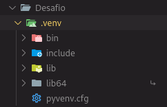
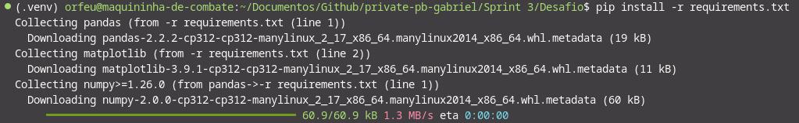

# Instruções para a Execução do projeto

> Este projeto esta sendo executado em um sistema operacional Linux: **_Fedora 40 Workstation_** portanto todos os comandos se referem a um Terminal Linux, se for executado em Windows utilize os comandos referentes ao Terminal Windows

## Criação do Virtual Enviroment

1. entre no diretório do Desafio pelo terminal
2. execute o comando `python -m venv ./.venv` para criar um ambiente virtual

> Dentro do diretório vai haver uma pasta chamada _.venv_ com todos os pacotes e arquivos executaveis de Python e versão que o seu sistema tem por padrão   

## Instalação dos Pacotes

1. Com o Ambiente virtual criado, o proximo passo é acessa-lo via terminal para poder instalar todos os Módulos necessários para este projeto
2. No terminal **Linux** Execute o comando `source ./.venv/bin/activate`, este comando acessa o ambiente virtual
3. Estando no Ambiente Virtual, execute o comando `pip install -r requirements.txt`, este comando vai instalar todos os pacotes necessarios para a execução deste projeto
   

# Etapas

1. ...
   [Etapa I](etapa-1/entrega.txt)

2. ...
   [Etapa II](etapa-2/entrega.txt)
