# Exercícios

1. Parte 1

- [Exercício 1](exercicios/ex1.py)
- [Exercício 2](exercicios/ex2.py)
- [Exercício 3](exercicios/ex3.py)
- [Exercício 4](exercicios/ex4.py)
- [Exercício 5](exercicios/ex5.py)

2. Parte 2

- [Exercício 6](exercicios/ex6.py)
- [Exercício 7](exercicios/ex7.py)
- [Exercício 8](exercicios/ex8.py)
- [Exercício 9](exercicios/ex9.py)
- [Exercício 10](exercicios/ex10.py)
- [Exercício 11](exercicios/ex11.py)
- [Exercício 12](exercicios/ex12.py)
- [Exercício 13](exercicios/ex13.py)
- [Exercício 14](exercicios/ex14.py)
- [Exercício 15](exercicios/ex15.py)
- [Exercício 16](exercicios/ex16.py)
- [Exercício 17](exercicios/ex17.py)
- [Exercício 18](exercicios/ex18.py)
- [Exercício 19](exercicios/ex19.py)
- [Exercício 20](exercicios/ex20.py)
- [Exercício 21](exercicios/ex21.py)
- [Exercício 22](exercicios/ex22.py)
- [Exercício 23](exercicios/ex23.py)
- [Exercício 24](exercicios/ex24.py)
- [Exercício 25](exercicios/ex25.py)

# Evidências

- Execução do Código do [Exercício 1](exercicios/ex1.py)  
  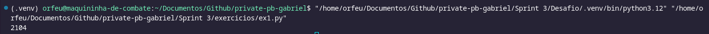

- Execução do Código do [Exercício 2](exercicios/ex2.py)  
  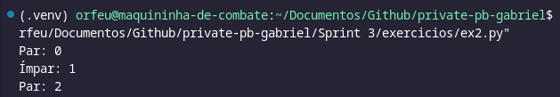

- Execução do Código do [Exercício 3](exercicios/ex3.py)  
  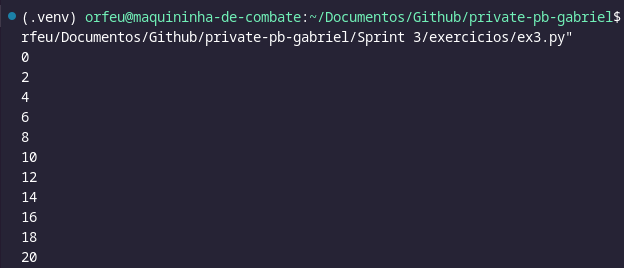

- Execução do Código do [Exercício 4](exercicios/ex4.py)  
  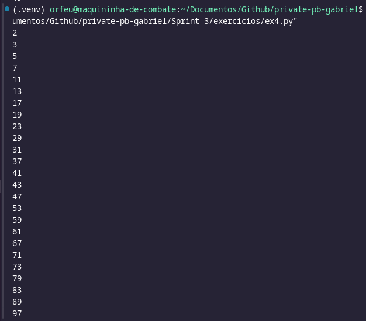

- Execução do Código do [Exercício 5](exercicios/ex5.py)  
  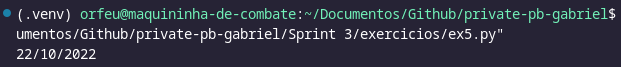

- Execução do Código do [Exercício 6](exercicios/ex6.py)  
  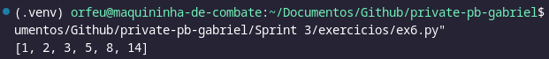

- Execução do Código do [Exercício 7](exercicios/ex7.py)  
  

- Execução do Código do [Exercício 8](exercicios/ex8.py)  
  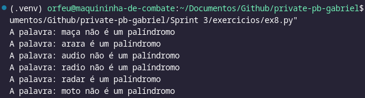

- Execução do Código do [Exercício 9](exercicios/ex9.py)  
  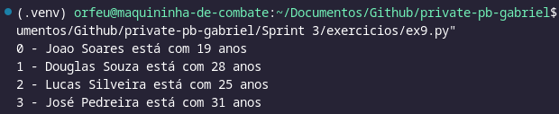

- Execução do Código do [Exercício 10](exercicios/ex10.py)  
  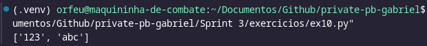

- Execução do Código do [Exercício 11](exercicios/ex11.py)  
  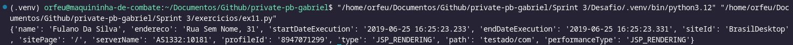

- Execução do Código do [Exercício 12](exercicios/ex12.py)  
  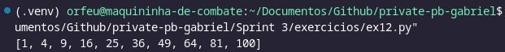

- Execução do Código do [Exercício 13](exercicios/ex13.py)  
  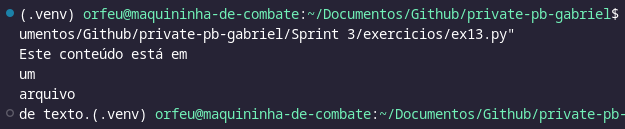

- Execução do Código do [Exercício 14](exercicios/ex14.py)  
  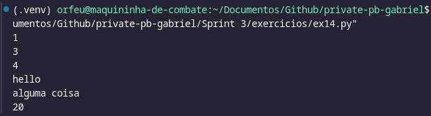

- Execução do Código do [Exercício 15](exercicios/ex15.py)  
  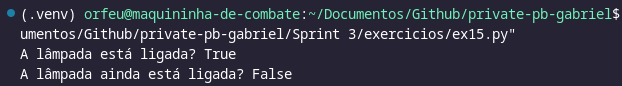

- Execução do Código do [Exercício 16](exercicios/ex16.py)  
  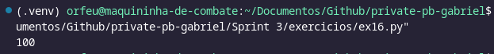

- Execução do Código do [Exercício 17](exercicios/ex17.py)  
  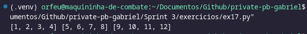

- Execução do Código do [Exercício 18](exercicios/ex18.py)  
  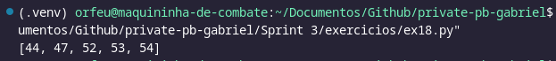

- Execução do Código do [Exercício 19](exercicios/ex19.py)  
  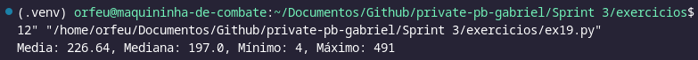

- Execução do Código do [Exercício 20](exercicios/ex20.py)  
  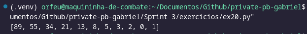

- Execução do Código do [Exercício 21](exercicios/ex21.py)  
  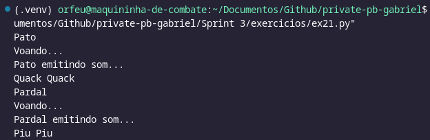

- Execução do Código do [Exercício 22](exercicios/ex22.py)  
  

- Execução do Código do [Exercício 23](exercicios/ex23.py)  
  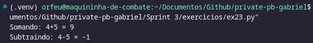

- Execução do Código do [Exercício 24](exercicios/ex24.py)  
  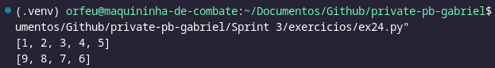

- Execução do Código do [Exercício 25](exercicios/ex25.py)  
  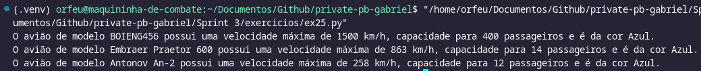

# Certificados
