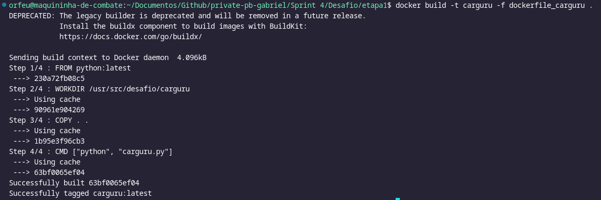
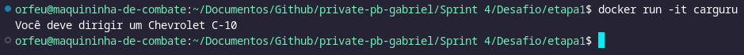
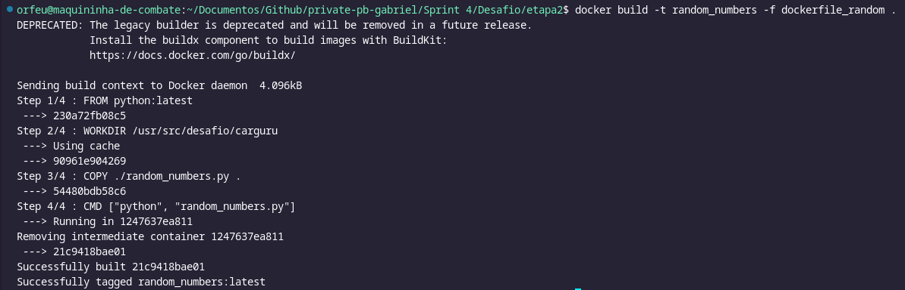
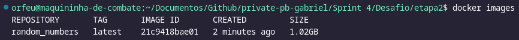
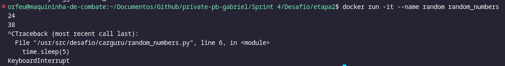
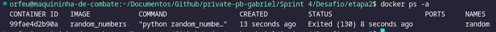
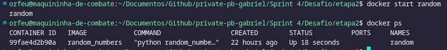
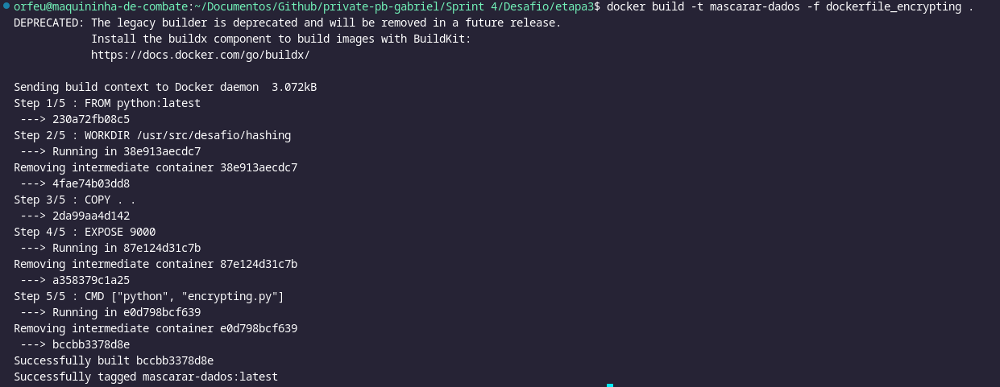
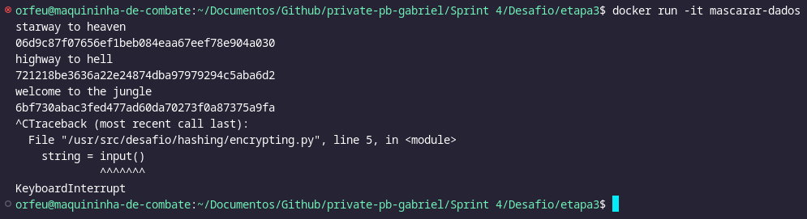

# Instruções

Nestes arquivos abaixo estao as explicacoes dos comandos utilizados nos arquivos e as instrucoes de execucao de cada etapa

# Etapas

## Etapa 1

Na primeira Etapa do Desafio é necessário construir uma imagem de docker com base neste [Script Python](etapa1/carguru.py), que pega aleatóriamente um nome de carro e retorna ao terminal. Para isto foi feito um arquivo [Dockerfile](etapa1/dockerfile_carguru), onde foi definido:

- a versão da imagem base utilizada (no caso a imagem de Python e a versão mais recente)
- diretório de trabalho dentro do sistema de docker
- o que teria dentro do diretório no inicio (feito uma copia da pasta raiz onde o dockerfile se encontra)
- e o comando a ser executado quando iniciasse o container utilizando esta imagem (neste caso executando o script Python no interpretador de Python)

E então a imagem foi Montada utilizando o comando

```shell
docker build -t carguru -f dockerfile_carguru .
```



Após a imagem ser criada, foi feito o teste criando um Container para checar se estava tudo certo com a Imagem.
Para este teste foi usado o comando para criar e rodar um container utilizando o Terminal interativo do mesmo

```shell
docker run -it carguru
```



## Etapa 2

_É possivel reiniciar Conteineres parados?_

**Sim é possivel reiniciar qualquer container parado em docker**

Primeira coisa que precisamos para mostrar como reiniciar um container é um rodando alguma aplicação, então por exemplo, printar numeros aleatórios no terminal

O [Script](random_numbers.py) tem um loop que se repete a cada 5 segundos, printando um numero aleatorio no terminal.

abaixo vamos criar uma imagem Docker com o arquivo

```shell
docker build -t random_numbers -f dockerfile_random .
```



Agora que temos a imagem Criada



vamos criar e executar um container utilizando o comando, entrando direto dentro do terminal interativo

```shell
docker run -it --name random random_numbers
```



> Note que eu já parei a execução dele com CTRL + C pois estava dentro do terminal interativo



Agora que o Container esta no estado Parado/Exited precisamos
apenas rodar o comando

```shell
docker start random
```



## Etapa 3

Para a terceira etapa do Desafio desta Sprint foi solicitado a criação de um [Script Python](etapa3/encrypting.py) que faça o mascaramento de Strings enviadas para ele.
este script deve possuir a seguinte runtime

1. Recebe uma String
2. gera um hashing SHA1
3. devolve a hash pelo terminal
4. Volta ao primeiro passo recebendo mais uma String

após a criação deste Script será criado uma imagem a partir de um [Dockerfile](etapa3/dockerfile_encrypting), seguindo o mesmo comando usado na etapa 1

```shell
docker build -t mascarar-dados -f dockerfile_encrypting .
```



Então após a criação da imagem, criar um container com ela para fazer o teste do hashing

```shell
docker run -it mascarar-dados
```


