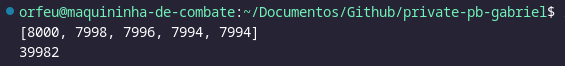
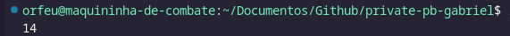
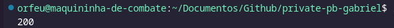
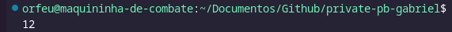
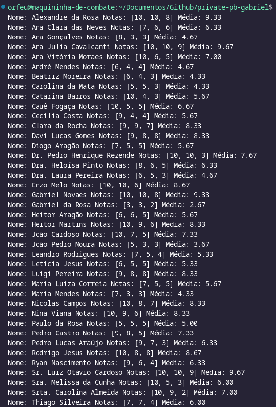
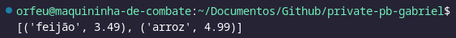
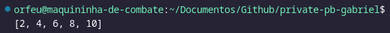

# Desafio

1. Etapa 1

   1. Arquivo de docker referente a criação da imagem -> [Dockerfile](Desafio/etapa1/dockerfile_carguru)
   1. Arquivo referente ao script Python entregue pelo desafio -> [carguru](Desafio/etapa1/carguru.py)

1. Etapa 2

   - Markdown onde esta a resposta da pergunta da segunda etapa [Reiniciar Container](Desafio/README.md)
   - [Script de exemplo](Desafio/etapa2/random_numbers.py)
   - [Docker File de exemplo](Desafio/etapa2/dockerfile_random)

1. Etapa 3

   - Arquivo de docker referente a criação da imagem -> [Dockerfile](Desafio/etapa3/dockerfile_encrypting)
   - Arquivo referente ao script Python desenvolvido para o Desafio -> [Encriptação](Desafio/etapa3/encrypting.py)

1. Caminho da entrega do Desafio
   - [Etapa 1.](Desafio/etapa1/)
   - [Etapa 2.](Desafio/etapa2/)
   - [Etapa 3.](Desafio/etapa3/)

# Exercicios

- [Exercício 1](exercicios/ex1.py)
- [Exercício 2](exercicios/ex2.py)
- [Exercício 3](exercicios/ex3.py)
- [Exercício 4](exercicios/ex4.py)
- [Exercício 5](exercicios/ex5.py)
- [Exercício 6](exercicios/ex6.py)
- [Exercício 7](exercicios/ex7.py)

# Evidências

- Execução do Código do [Exercício 1](exercicios/ex1.py)  
  
- Execução do Código do [Exercício 2](exercicios/ex2.py)  
  
- Execução do Código do [Exercício 3](exercicios/ex3.py)  
  
- Execução do Código do [Exercício 4](exercicios/ex4.py)  
  
- Execução do Código do [Exercício 5](exercicios/ex5.py)  
  
- Execução do Código do [Exercício 6](exercicios/ex6.py)  
  
- Execução do Código do [Exercício 7](exercicios/ex7.py)  
  

# Aprendizados

## Curso Estatistica Descritiva

### Estatistica Descritiva

- Coleta
- Análise
- Interpretação
- Representação

---

Hoje em dia uma grande quantidade de dados são gerados a cada instante e isso tende a aumentar, mas
dados sem sentido não tem utilidade, por isso é preciso a análise destes dados para dar um uso a eles.  
Por Exemplo, a grande quantidade de dados geradas pela rede social Instagram, pode se tirar inumeras respostas
pra comportamentos humanos e melhorar cada vez mais propagandas e publicações, não só o algoritmo de recomendação dos proprios posts
mas também a recomendação de propagandas que se enquadram com os gostos dos usuários baseado no que eles pesquisam e
curtem na rede social, essa é uma das aplicações, poder compreender o comportamento do ser humano em meio a redes sociais

> 3V's Principais do Big data
>
> - Volume
> - Velocidade
> - Variedade

#### Fundamentos da Estatistica

#### Representações Gráficas

#### Medidas de Tendencia Central

#### Medidas de Dispersão

#### Medidas de Assimetria

#### Aplicações
