# Instruções para a Execução do projeto

> Este projeto esta sendo executado em um sistema operacional Linux: **_Fedora 40 Workstation_** portanto todos os comandos se referem a um Terminal Linux, se for executado em Windows utilize os comandos referentes ao Terminal Windows

## Criação do Virtual Enviroment

1. entre no diretório do Desafio pelo terminal <br>
   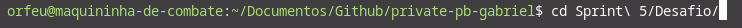
2. execute o comando `python -m venv ./.venv` para criar um ambiente virtual <br>
   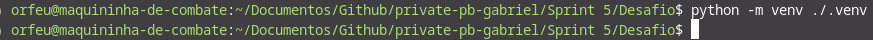

> Dentro do diretório vai haver uma pasta chamada _.venv_ com todos os pacotes e arquivos executaveis de Python e versão que o seu sistema tem por padrão <br>

## Instalação dos Pacotes

1. Com o Ambiente virtual criado, o proximo passo é acessa-lo via terminal para poder instalar todos os Módulos necessários para este projeto
2. No terminal **Linux** Execute o comando `source ./.venv/bin/activate`, este comando acessa o ambiente virtual
3. Estando no Ambiente Virtual, execute o comando `pip install -r requirements.txt`, este comando vai instalar todos os pacotes necessarios para a execução deste projeto <br>
   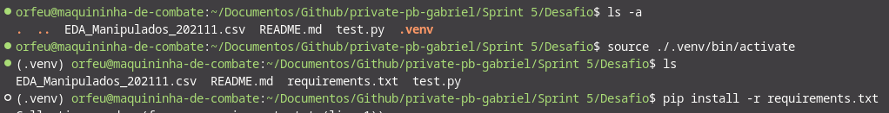

# Etapas

Neste desafio é necessário

- Selecionar um CSV no [Site](http://dados.gov.br)
- Importa-los em um Bucket S3
- Utilizar o S3 Select ou Boto3 para fazer consultas

os arquivos deste Desafio são

- [Etapa 1](pre_processing.py)
- [Etapa 2](s3_queries.py)
- [Requirements do pip](requirements.txt)
- [SQL consulta 1](sql/query_1.sql)
- [SQL consulta 2](sql/query_2.sql)
- [CSV escolhido](sustentabilidade_-_agua_2022.csv)

## Conjunto de Dados

O conjunto de dados que eu escolhi se refere ao consumo de agua da Universidade Federal de Uberlândia, contemplando as cidades e campus, e também o consumo de agua em Metros cubidos em meses de 2022

Primeiro passo após a escolha do CSV é checar se as Constantes do projeto estão corretas e se os diretórios existem
<br>

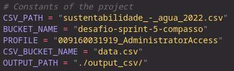 <br>
também é necessário ajustar as credenciais do Amazon CLI, ou alterar elas utilizando

```bash
nano ~/.aws/credentials
```

## Etapa 1

A primeira Etapa do projeto é dar uma limpada/tratada nos dados para que se diminua a quantidade de erros na importação dos dados no Bucket. <br>
Então limpei um pouco dados nulos e troquei alguns dados estavam em formatos indesejados e então salvei o arquivo novamente <br>
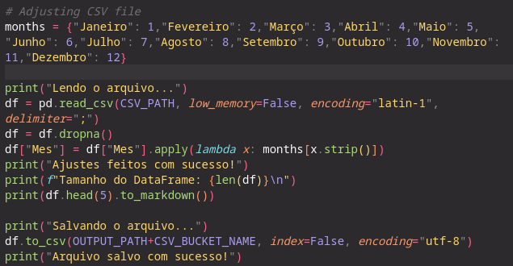

Após a limpeza do arquivo, então ele deve ser enviado para o Bucket na AWS <br>
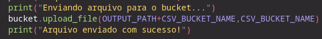

## Etapa 2

Na segunda etapa temos a parte de pesquisa feita em cima do CSV no Bucket.
Novamente é preciso checar as constantes do script para garantir que não ocorra erros de comunicação com a AWS

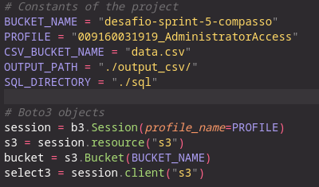

Fiz uma função para receber uma resposta de query da AWS e converte-la novamente para um CSV

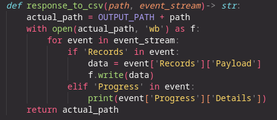

### Primeira Query

Então na primeira Query é pego o SQL de um arquivo e adicionado a uma variavel denominada SQL e criado uma requisição de Select no bucket

após o retorno da requisição é criado um CSV utilizando a função explicada acima

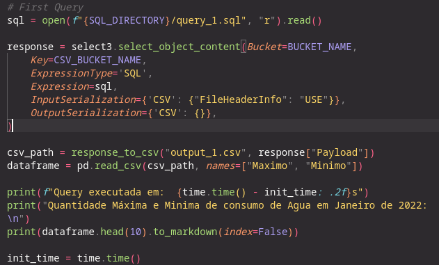

Então é criado um Dataframe para fins de Mostrar os resultados no terminal
como mostra abaixo

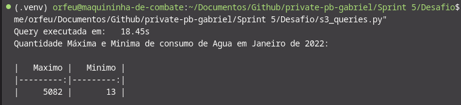

### Segunda Query

Na segunda Query também é retirado o SQL de um arquivo e adicionado a uma variavel demoninada SQL e então é criado uma requisição de Select no bucket

Após retornar a requisição é criado um CSV utilizando a Função criada

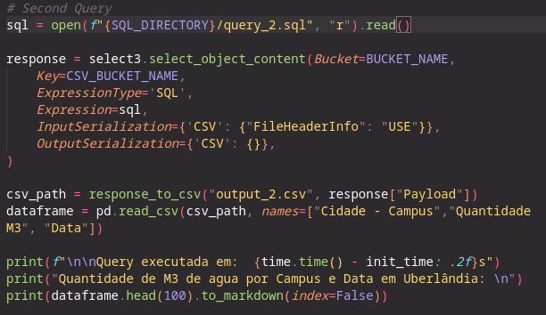

e então a fim de mostrar os dados de uma maneira mais organizada no terminal é feito um Dataframe e o print dele

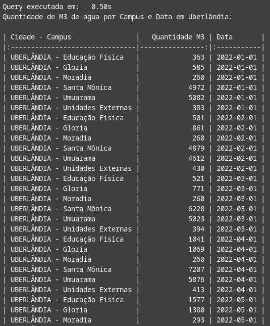
