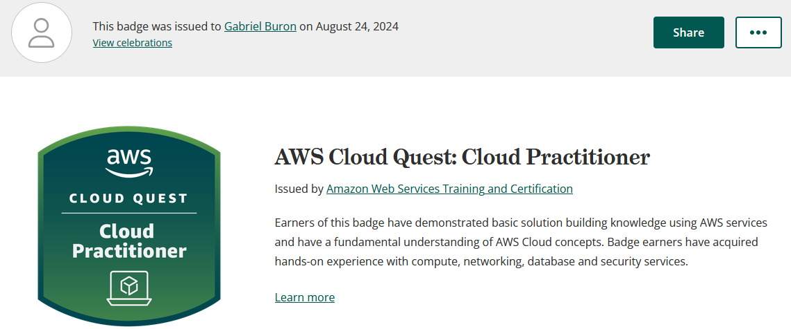

# Desafio

os arquivos referentes ao desafio

- [Markdown Referente a Entrega do Desafio](Desafio/README.md)
- [Etapa 1](Desafio/pre_processing.py)
- [Etapa 2](Desafio/s3_queries.py)
- [Requirements do pip](Desafio/requirements.txt)
- [SQL consulta 1](Desafio/sql/query_1.sql)
- [SQL consulta 2](Desafio/sql/query_2.sql)
- [CSV escolhido](Desafio/sustentabilidade_-_agua_2022.csv)

# Certificações

Certificado Cloud Pratictioner

