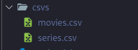
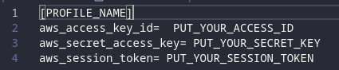
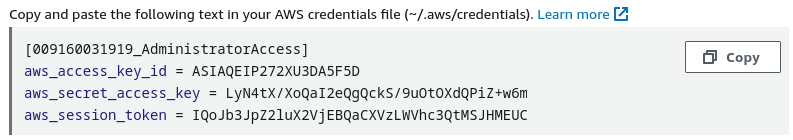
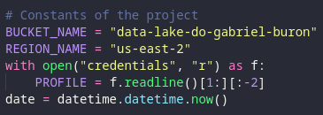
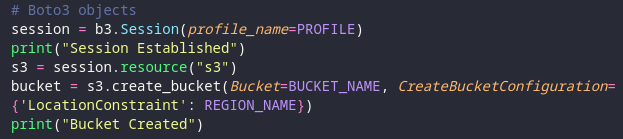
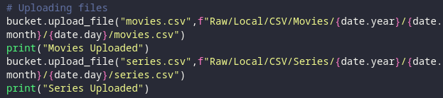
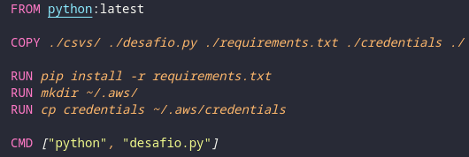
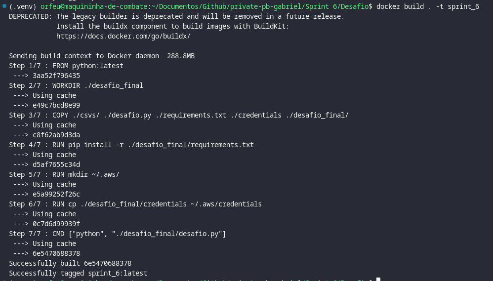
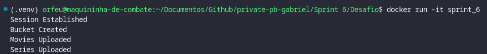
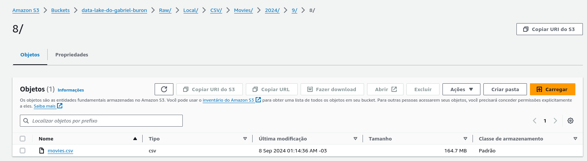

# Instruções para a Execução do projeto

> Este projeto esta sendo executado em um sistema operacional Linux: **_Fedora 40 Workstation_** portanto todos os comandos se referem a um Terminal Linux, se for executado em Windows utilize os comandos referentes ao Terminal Windows

# Etapas

O desafio da Sprint 6 consiste em uma injeção de dados em um S3, para nas próximas Sprints poder serem análisados

## Etapa 1

Primeira coisa que se deve fazer antes de rodar o código é arrumar alguns diretórios e arquivos

- Na pasta `csvs/` é onde será colocado os dois arquivos csv utilizados, no caso o `movies.csv` e o `series.csv` <br>



- deve ser criado um arquivo Credentials com as seguintes informações
  - `[PROFILE_NAME]` Onde deve ser colocado o nome do perfil utilizado para a AWS
  - `aws_access_key_id=` Onde deve ser coloado o ID de acesso dado pela AWS
  - `aws_secret_access_key=` Onde deve ser colocado o key de acesso dada pela AWS
  - `aws_session_token=` Onde deve ser colocado o Token de acesso dado pela AWS > Existe no diretório do Desafio um arquivo chamado `credentials.example` que indica como deve ficar estruturado o arquivo credentials





Após ser alterado essas coisas pode se dar o inicio ao Desafio

## Etapa 2

Nessa segunda etapa vou explicar um pouco sobre o código em Python que estará rodando dentro do Container de Docker, ele é divido em 3 partes

### Constantes do Projeto

Nesta parte é configurado constantes que vão se manter durante o código e não serão alteradas, como o Nome do Bucket e Região, e por fim ele pega o Usuário utilizado no arquivo Credentials



### Criação do Bucket

Nesta parte definimos os objetos necessários para o código,

1. criando um objeto de sessão com o Boto e AWS usando o profile
2. selecionado o recurso de S3
3. criado o bucket na região estabelecida previamente



### Importação dos CSV

Após criado o Bucket deve ser inserido os dados dentro dele, como indicado nas instruções o caminho de pastas dentro do Bucket deve seguir como o seguinte

`Raw/Local/CSV/(Movies ou Series)/ANO/MES/DIA/arquivo.csv`

então é necessário passar também a data como diretório



## Etapa 3

Nesta terceira etapa é necessário criar uma imagem de docker que execute o código, para isto será usado um dockerfile



Dentro deste dockerfile existe as seguintes instruções

1. Utilizar a Imagem do Python mais recente
2. Copiar os arquivos necessários para dentro do container
3. Instalar as dependencias do Python utilizando o Pip
4. Criar a pasta da AWS para colocar as credenciais
5. copiar o arquivo de credenciais
6. Quando o Container for criado, executar o código Python

Com este dockerfile pronto, é possivel já criar a imagem utilizando o comando

```shell
docker build . -t sprint_6
```



## Etapa 4

Com a imagem já criada, tudo o que resta é criar o container para testar se esta funcionando, utilizando o comando

```shell
docker run -it sprint_6
```

então o código abaixo sera executado dentro de um terminal interativo



Assim que finalizado a execução do código, deve ficar desta maneira o bucket


