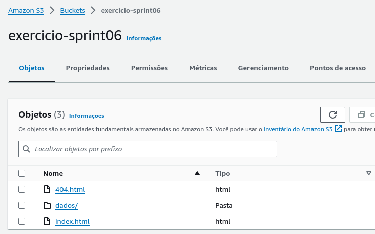
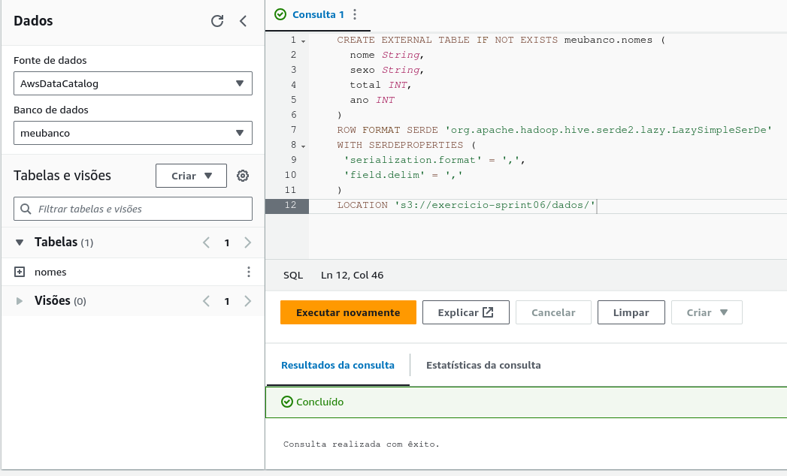
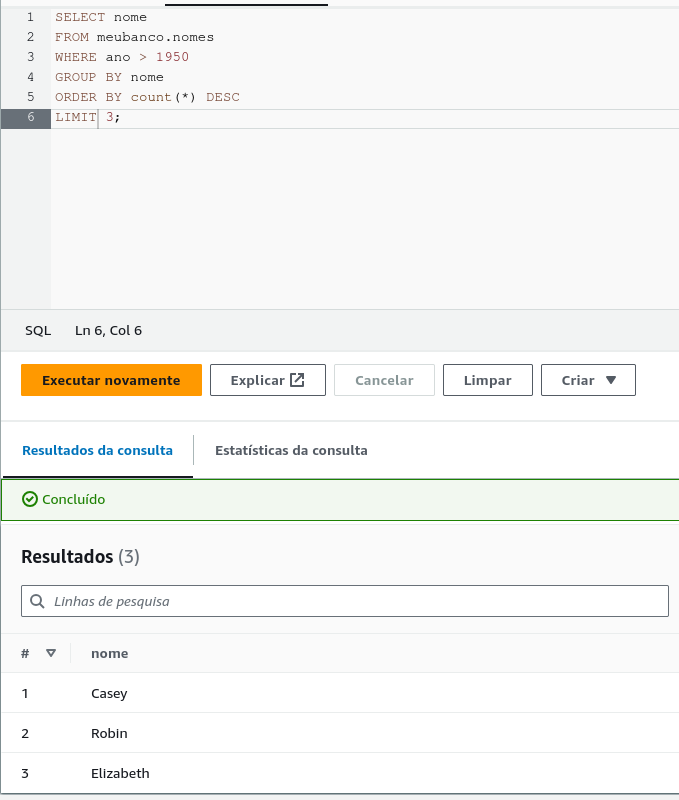
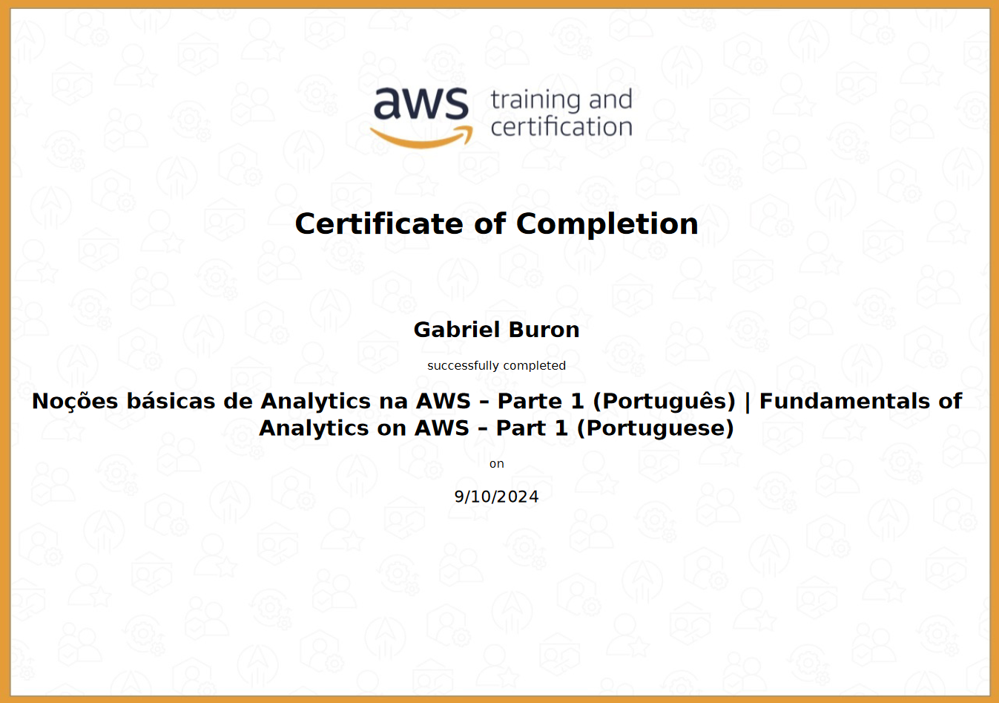

# Desafio

os arquivos referentes ao desafio

- [Script Python executado no Docker](Desafio/desafio.py)
- [Markdown Referente a Entrega do Desafio](Desafio/README.md)
- [Requirements do pip](Desafio/requirements.txt)
- [Dockerfile para Criar a Imagem](Desafio/dockerfile)

## Escolha para o Desafio Final

Para o desafio final é necessário escolher uma pergunta chave que será respondida com a nossa análise, não se prendendo a apenas uma pergunta.
A minha decisão de pergunta que eu quero responder com este Desafio é a seguinte

- **O quão Popular é as Triologias de filmes de Tolkien, Senhor dos Aneis e Hobbit**
- Em comparação a outros filmes de fantasia, os Filmes de Tolkien são um destaque?
- Em comparação a outras sequencias grandes de filmes como _Star Wars_, Senhor dos Aneis e Hobbit conseguem se destacar? em qual Métrica?

em suma é este tipo de análise que eu quero fazer neste desafio Final

# Exercicios

## Exercicio 1

No primeiro exercicio é necessário criar um Bucket S3 e alterar suas propriedades para poder hospedar um site estático
como mostra nas imagens abaixo o site foi criada

e aqui temos os objetos do Bucket

## Exercicio 2

No segundo exercicio utilizamos o Athena para filtrar consultar o CSV importado no primeiro exercicio,
primeiramente precisamos criar um banco de dados no Athena, e então criar uma tabela dentro dele referenciando o CSV

e em seguida como pedido no exercicio foi feito uma consulta para retornar os 3 nomes mais utilizados

# Certificações

Certificado de Nocoes Basicas de Analytics

