# Instruções para a Execução do projeto

> Este projeto esta sendo executado em um sistema operacional Linux: **_Fedora 40 Workstation_** portanto todos os comandos se referem a um Terminal Linux, se for executado em Windows utilize os comandos referentes ao Terminal Windows

## Criação do Virtual Enviroment

1. entre no diretório do Desafio pelo terminal  
2. execute o comando `python -m venv ./.venv` para criar um ambiente virtual  
   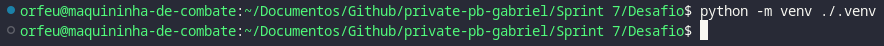

> Dentro do diretório vai haver uma pasta chamada _.venv_ com todos os pacotes e arquivos executaveis de Python e versão que o seu sistema tem por padrão  

## Instalação dos Pacotes

1. Com o Ambiente virtual criado, o proximo passo é acessa-lo via terminal para poder instalar todos os Módulos necessários para este projeto
2. No terminal **Linux** Execute o comando `source ./.venv/bin/activate`, este comando acessa o ambiente virtual
3. Estando no Ambiente Virtual, execute o comando `pip install -r requirements.txt`, este comando vai instalar todos os pacotes necessarios para a execução deste projeto  
   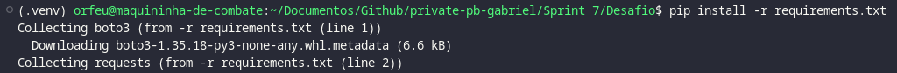

# Etapa 1

Bom, antes de poder criar o código era preciso pensar em quais informações poderiam ser adquiridas da API do _The Movie Database_, então com algumas pesquisas
na documentação da API decidi fazer algumas ligações entre informações que poderia retirar da Database sendo elas

1. Rota _Find By ID_
2. Rota _Details_
3. Rota _KeyWords_
4. Rota _Movie Discover_

Utilizando estas rotas eu poderia saber informações mais detalhadas na triologia de filmes _Lord of the Rings_ e do _Hobbit_, e dados atualizados referentes a filmes que lançaram tanto 20 anos antes quanto 20 depois para poder comparar algumas coisas.
Também resolvi utilizar a rota de KeyWords, para tentar achar alguma correlação de assunto entre os filmes populares antes desta sequencia de filmes ser lançada e filmes lançadas após a sequencia de filmes.

> Ids do CSV dos filmes análisados
> LOTR ids = [tt0120737, tt0167260, tt0167261]
> Hobbit ids = [tt0903624, tt1170358, tt2310332]

# Etapa 2

Agora passando para o Desevolvimento da função de Lambda, utilizei 2 modulos de Python externos baixados pelo _pip_, sendo eles o _requests_ utilizado pela documentação do TMDB e o boto3 para conexão com o S3 (Dentro da Lambda boto3 já vem instalado por default).

## Definição de Variaveis / Constantes

Logo no Inicio do Script é importado os pacotes necessários e definido algumas constantes que serão utilizadas dentro das requisições, como por exemplo o nome dos Buckets e o ID dos filmes que preciso do CSV, após ter configurado certo essas Constantes é feito duas coisas.

1. Conectar o boto com o bucket
2. Criar o Header do TMDB com a API KEY necessária para as requisições

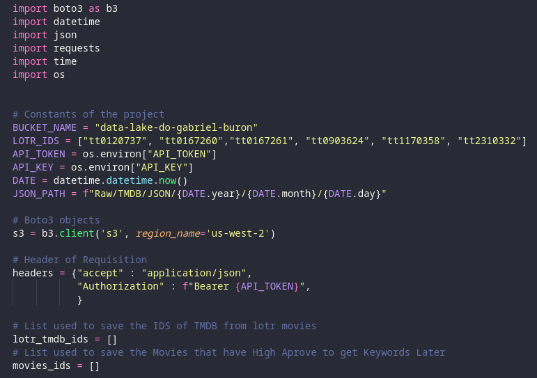

## Função de Requisição

eu tentei manter um modelo em si de como seria feito as requisições, como mostra no Workflow de Mermaid abaixo

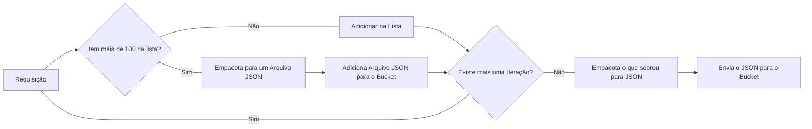

Então resumindo, todas as requisições funcionaram a base de Loops para receber dados, como exemplo esta Função abaixo:

1. Pega todos os IDS de filmes com nota acima de 7.0 das pesquisas anteriores para uma Iteração
2. Utiliza o ID para fazer uma requisição das palavras chave desses filmes
3. checa se na lista onde é guardado as requisições já existe 100 itens
4. Caso não exista 100 itens ele adiciona o JSON na lista e parte pra proxima iteração
5. Caso Exista 100 Itens, ele empacota toda a lista em um JSON unico e envia para dentro do Bucket então volta a Iterar
6. Quando a Iteração acaba ele empacota o resto da lista e manda para o Bucket

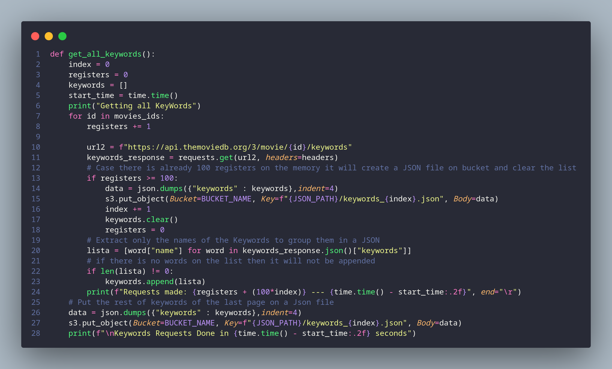

## Função Handler do Lambda

Bom, como este código é adicionado ao Lambda, é importante existir a função que será chamada por ele.
com base nisso criei esta função que é a execução das requisições e por fim um retorno para o Lambda dizendo se funcionou ou não as requisições

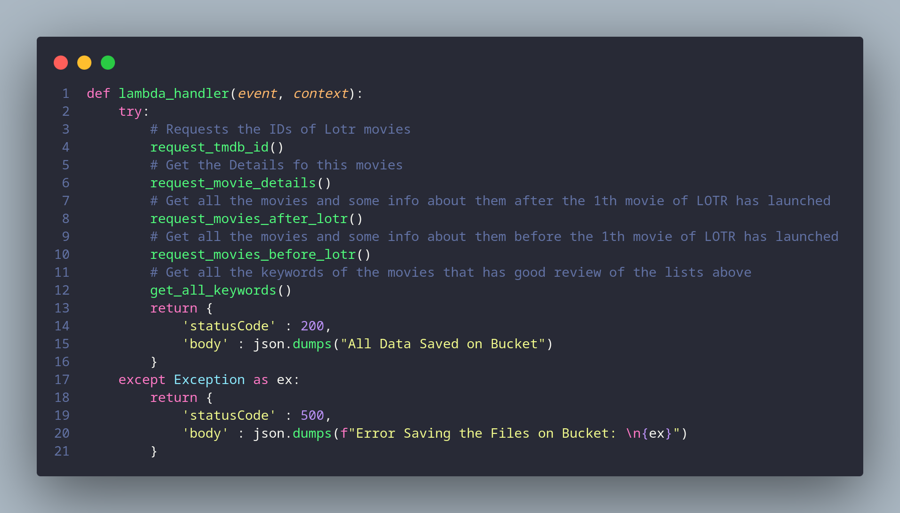

# Etapa 3

Esta etapa é referente a configuração de tudo na AWS

## Criação da Lambda

No Console da AWS foi criado uma função Lambda chamada _get-jsons-datalake_ e dentro dela foi importado este código

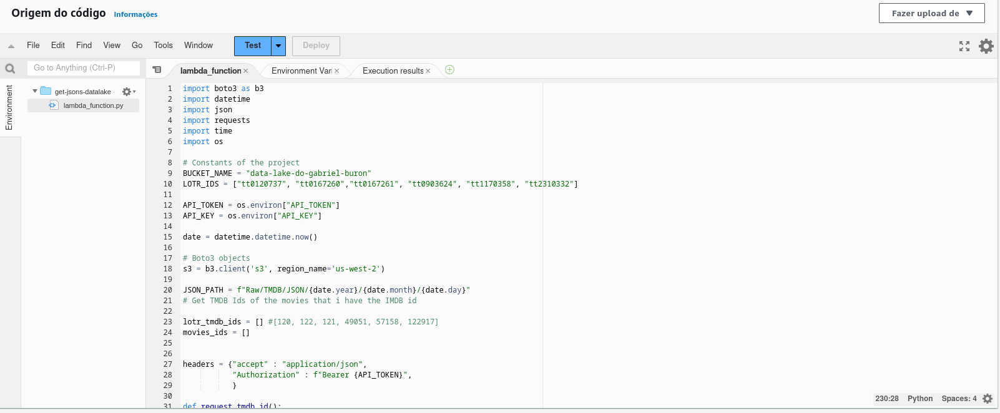

Após ser adicionado o Código foi necessário rodar a função pelo menos uma vez para gerar as Roles no IAM.

## Alteração de permissões da Função

Dentro do IAM foi alterado as permissões da Role referente a esta função, no caso, adicionado a permissão para manuseamento do serviço S3 da AWS

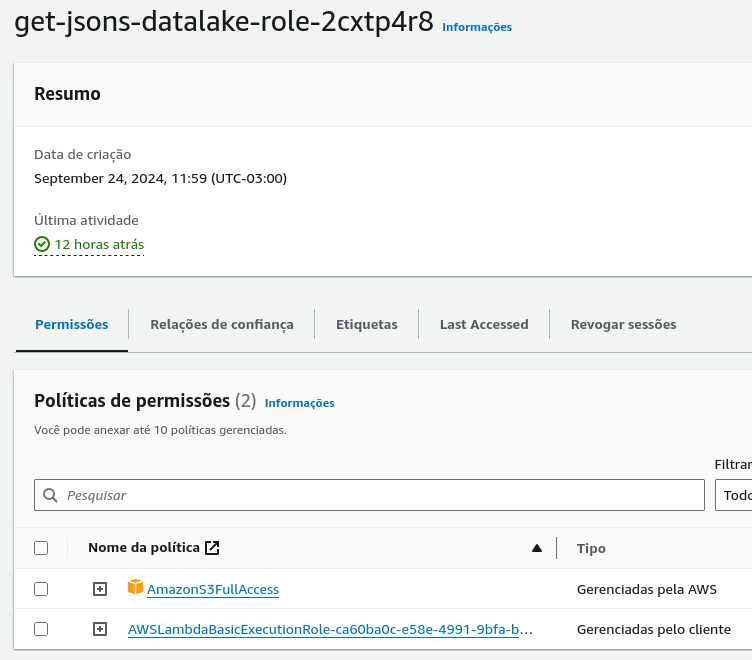

## Layers Utilizadas

Como é necessário libraries Externas ao Lambda, foi preciso criar uma pasta e instalar estas Libraries via pip, então compacta-la e adicionar dentro do Lambda como uma Layer

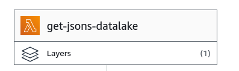
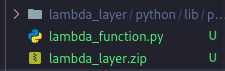

## Agendamento Bucket

Como uma função Lambda necessita de um evento para ser executada, e para uma análise mais completa eu criei um evento que acontece toda segunda a meia noite para ser executada a função, puxando todos os dados novamente já que pode ter alteração em alguns parametros como numero de análises e notas, dados que são variaveis com o tempo

## Bucket

Como por fim, temos a confirmação de que dento do Bucket os arquivos estão armazenados, estando todos em formato JSON dentro do

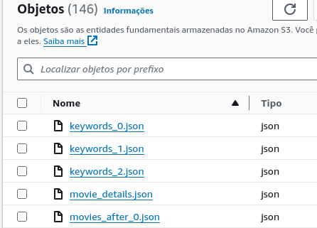
