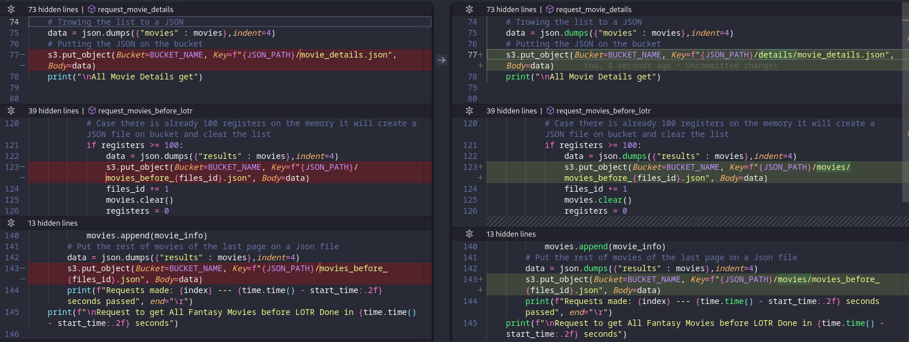
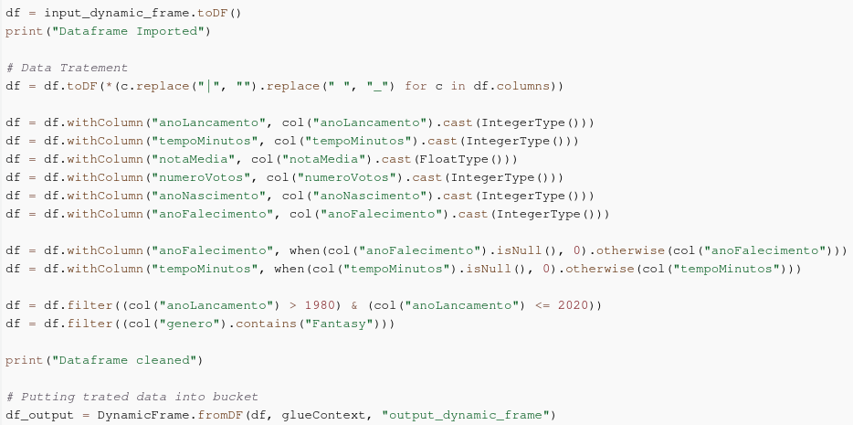
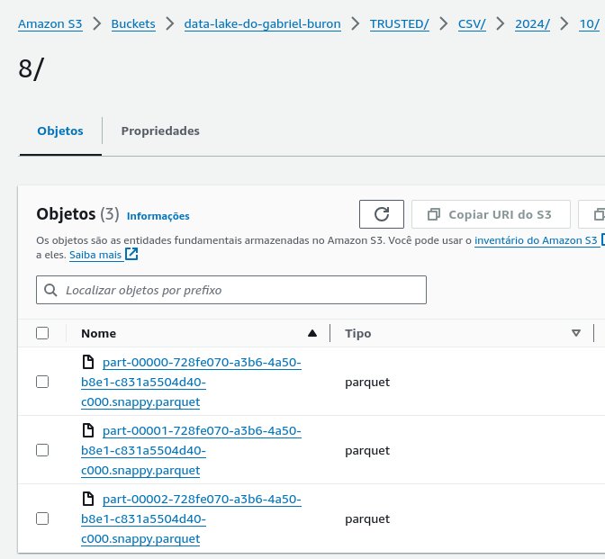
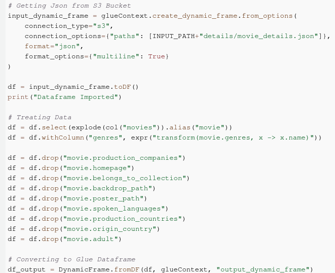
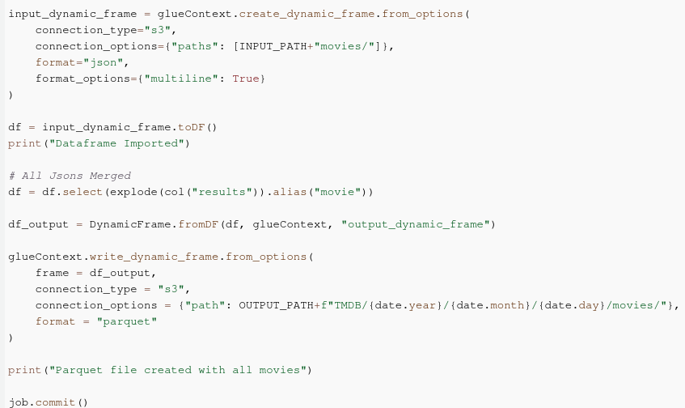
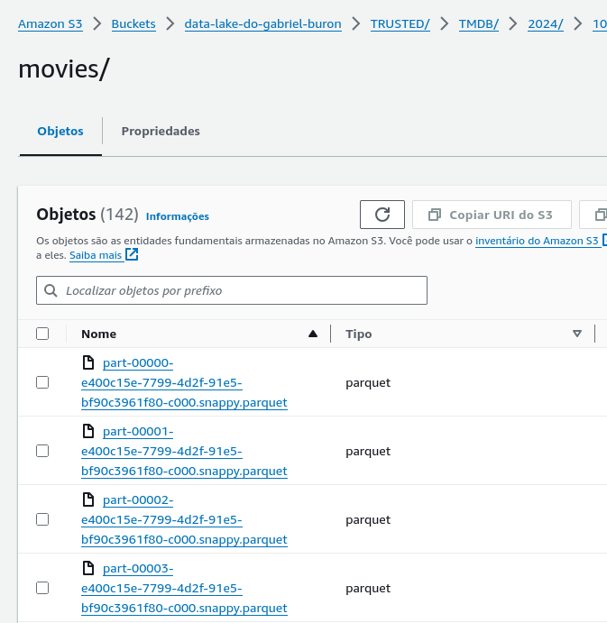

# Desafio Sprint 8

Para a Sprint 8 era necessário formalizar todos os dados que obtivemos nas duas últimas Sprints em um único tipo de arquivo, neste caso Parquet, assim como dar uma limpeza nos dados.

## Etapas

Para conseguir ser feito a transformaçãod e dados como Json foi necessário alterar e re-rodar o desafio da Sprint 7.

A alteração feita foi no diretório onde eram guardados os arquivos Jsons provenientes do TMDB, já que eram rotas diferentes com informações diferentes o problema era para poder unir estas informações, então foi criado além de dois parquets diferentes, também pastas diferentes na Raw para que fosse possivel retornar todos os jsons de seus determinados assuntos

### Job para tratamento de dados CSV

Glue é Iniciado e configurado, então o CSV é aberto como um DynamicFrame, e então convertido para um DataFrae do Spark para começar o tratamento dos dados.

1. **Alteração de todas as colunas que lidam com números para inteiros:**

2. **Alteração para ser filtrado apenas filmes entre os anos 1980 e 2020:**

3. **Filtragem por Gênero nos CSVs:**

Após o DataFrame ter seus dados tratados, ele é convertido de volta para _DynamicFrame_ para que os dados possam ser escritos para Parquet e enviados ao S3, após isso o Job é finalizado.

### Job para o tratamento de dados dos Jsons

Glue é Iniciado e configurado.

Logo após isso o glue abre o Json de Detalhes como um _DynamicFrame_ e então converte para um Dataframe do Spark para tratamento de dados.

1. **Altera a coluna de Generos deixando apenas uma lista com os nomes**
2. **Exclui Colunas desnecessárias para a análise**

Após o DataFrame ter seus dados tratados, ele é convertido de volta para _DynamicFrame_ para que os dados possam ser escritos para Parquet e enviados ao S3.

então é pego os dados provenientes de outros arquivos Jsons, com dados referentes a filmes no geral, _neste caso não é apenas um arquivo e sim varios então é passado uma pasta inteira com os jsons para o glue abrir_

após o Glue criar o _DynamicFrame_ convertemos ele para o Dataframe usado pelo Pyspark, tudo que é feito em seguida se resume a juntar os dados de todos os Jsons, ou seja, ele explode o Json, retornando a lista e integrando todas elas em um unico Dataframe e Parquet

Logo após isso ele é convertido de volta para _DynamicFrame_ para que os dados possam ser escritos para Parquet e enviados ao S3.

após isso o Job é finalizado.

