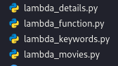
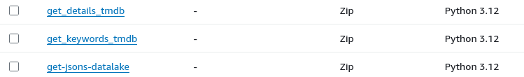
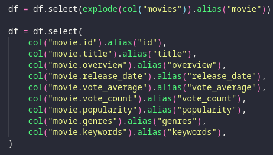
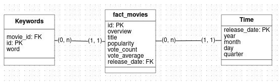
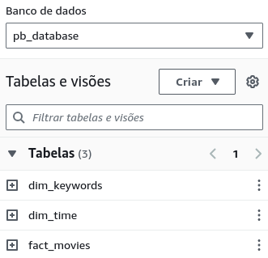

# Desafio Sprint 8

Para a Sprint 9 era necessário refinar os dados e montar um modelo dimensional, para que fosse feito tudo isto foi necessário voltar algumas Sprints e alterar alguns códigos com a finalidade de gerar informações que possam ser trabalhadas em um modelo dimensional

## Etapas

Para conseguir completar este desafio foi necessário fazer algumas mudanças em outras Sprints

### Sprint 7

Como uma maneira melhor de mexer com os dados foi alterado a maneira na qual era salvo na Raw as rotas de filmes, antes eram separados entre filmes antes e pós o primeiro filme de senhor dos aneis, agora foi unido ambos em uma função separada para fins de boas práticas, então foi criado e alterado os seguintes arquivos

Cada um destes arquivos referencia uma função lambda, separados justamente por cada um deles fazer algo diferente, o workflow do código segue o mesmo

### Sprint 8

Como o conteudo da Sprint 7 foi mudado também precisou se ter algumas mudanças sobre quais informações seriam usadas e onde seriam buscadas, então algumas das mudanças mais significativas em código desta Sprint foram em transformarem os Jsons em uma estrutura mais relacional que poderia ser lida em uma tabela (Como mostrado na imagem abaixo)

Além disso já foi filtrado os dados para serem inseridos como um Parquet, um formato de arquivo mais universal para se armazenar dados referentes a Big Data e Data Analysis

### Sprint 9

Na Sprint 9 fazemos a Modelagem Dimensional e a concretização destas tabelas, para isso foi feito algumas filtragens e ajustes em tabelas por Jobs e após isso os Crawlers recebem a tarefa de converter os parquets da camada Refined em uma tabela no Banco de Dados

Logo abaixo temos o Modelo Dimensional Logico, mostrando a Tabela de Fatos e as suas devidas Dimensões que podem ser usadas para fazer uma análise mais refinada sobre

#### Job para criar a tabela de palavras-chave

Glue é Iniciado e configurado, então é puxado para a memória o parquet de palavras-chave

1. **O dataframe é Iniciado e convertido em uma lista de linhas**

2. **Após isso é passado em cada linha e desmembrado as suas palavras chaves**

3. **cada palavra é adicionada junto dos Ids dos filmes em uma tupla**

4. **a tupla é adicionada dentro de uma lista de palavras**

5. **a lista é convertida em um daframe de saida e enviada para o S3**

Após esse refinamento de dados eu tenho uma tabela com as palavras separadas por filmes mas de uma maneira na qual seja facil a filtragem dos dados e de compreensão na hora de fazer as buscas no quicksight

#### Job para os Filmes

Glue é Iniciado e configurado.

Logo após isso o glue abre o Parquet com as informações de filmes

1. **O Dataframe de Filmes é passado adiante para a camada Refined**
2. **É criado um Dataframe novo chamado de Dimensão tempo com a data dos filmes da tabela de Fatos**
3. **O Dataframe de Tempo é colocado na camada Refined**

Com isso eu possuo uma Tabela no Banco de dados com todos os Fatos e métricas e algumas chaves para a consulta e uma Tabela com todas as Datas e informações mais detalhadas de tempo

---

No fim da Sprint eu possuo estas tabelas para poder trabalhar na Sprint 10

